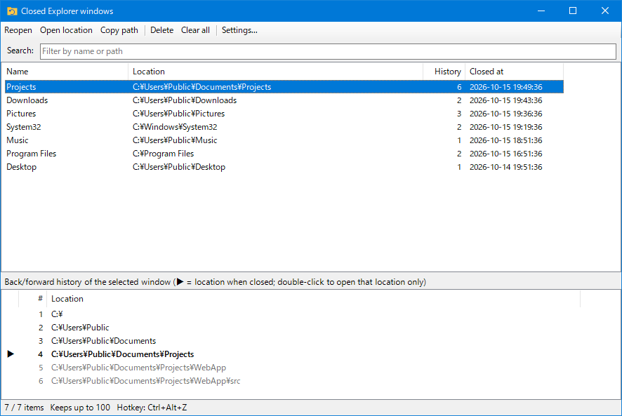
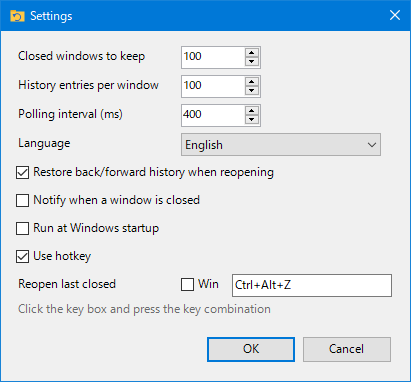

# ReopenExplorer

[日本語](README.md) | English

A system tray app that reopens recently closed File Explorer windows **together with their back/forward history**.

## Features

- Automatically records closed Explorer windows (100 by default, kept across restarts)
- Reopen the last closed window with a hotkey (`Ctrl+Alt+Z` by default, configurable)
- Restores the "Back" and "Forward" history when reopening
- History window: search, reopen, open location only, copy path, delete
- Shows the back/forward history of the selected window, and lets you open any single location from it
- Settings: number of entries, history length, polling interval, language, hotkey, notifications, run at Windows startup
- Japanese / English UI (defaults to the Windows display language).  
Other languages can be added with a language file

## Requirements

- Windows 10 / 11
- [.NET 10 Desktop Runtime](https://dotnet.microsoft.com/download/dotnet/10.0)

## Usage

| Action | Result |
| --- | --- |
| Double-click the tray icon | Show the history window |
| Right-click the tray icon | Reopen last, recently closed windows (15), settings, exit |
| Hotkey (default `Ctrl+Alt+Z`) | Reopen the last closed window |

### History window

| Action | Result |
| --- | --- |
| Double-click / `Enter` | Reopen with history |
| `Delete` | Remove from the list |
| `Ctrl+F` | Move to the search box |
| `Ctrl+A` | Select all |
| Double-click an entry in the lower list | Open only that location in a new window |

In the lower list, `▶` marks the location shown when the window was closed. Gray rows are "Forward" history.

### Settings

| Item | Default |
| --- | --- |
| Closed windows to keep | 100 |
| History entries per window | 100 |
| Polling interval | 400 ms |
| Language | Auto (Japanese if the Windows display language is Japanese, otherwise English). Switches immediately when selected |
| Restore back/forward history | On |
| Notify when a window is closed | Off |
| Run at Windows startup | Off (registered under `HKCU\...\Run`) |
| Hotkey | `Ctrl+Alt+Z` (click the key box and press a combination; the Win key is set with the checkbox) |

## Adding a language

- To add a language, copy `en.json` to a name like `fr.json`, translate the values, and put the display name in `"_name"`.

## Data location

`%APPDATA%\ReopenExplorer\`

- `closed.json` … history of closed windows
- `settings.json` … settings

## How it works and limitations

- The app polls `Shell.Application`'s `Windows()` at a fixed interval and infers each window's back/forward history from changes in the displayed folder. Explorer's internal history cannot be read from outside, so navigation before the app started, or navigation faster than the polling interval, is not recorded.
- When reopening, the app opens a new window at the first history location, navigates through each location in order, then presses "Back" as many times as needed to reproduce the state. Long histories take a little time.
- On Windows 11 tabbed Explorer, multiple tabs in the same window cannot be distinguished.
